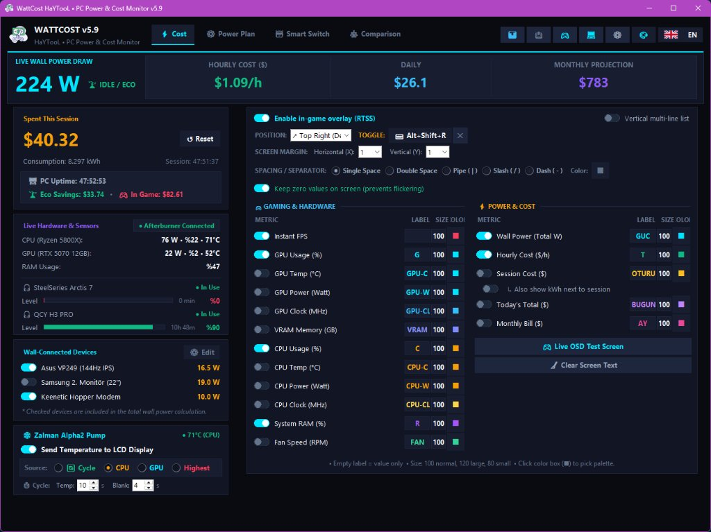
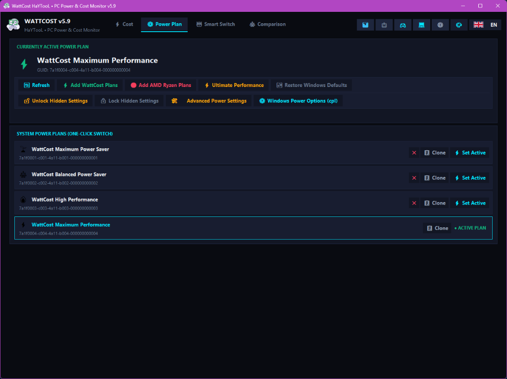
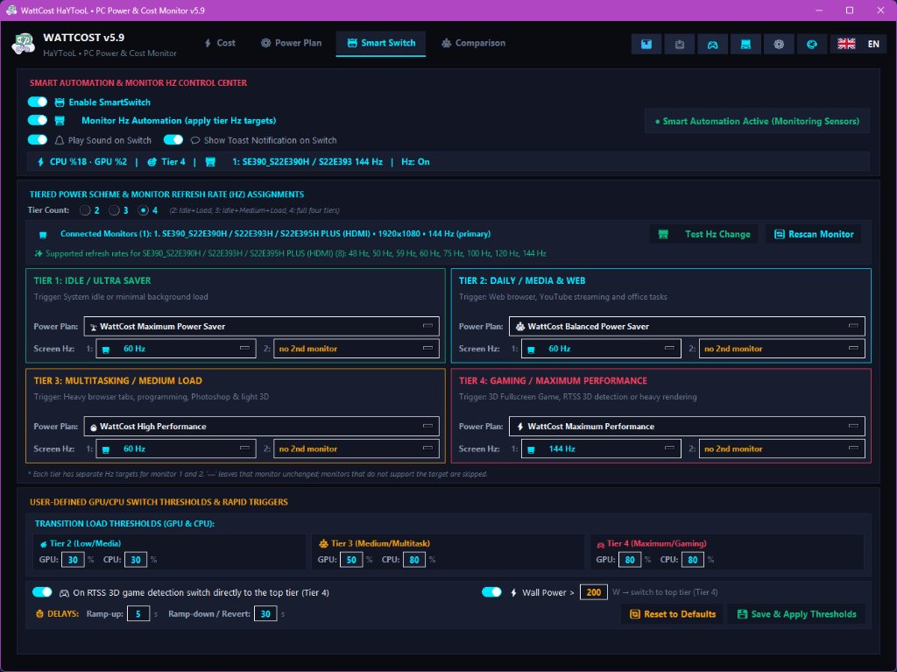
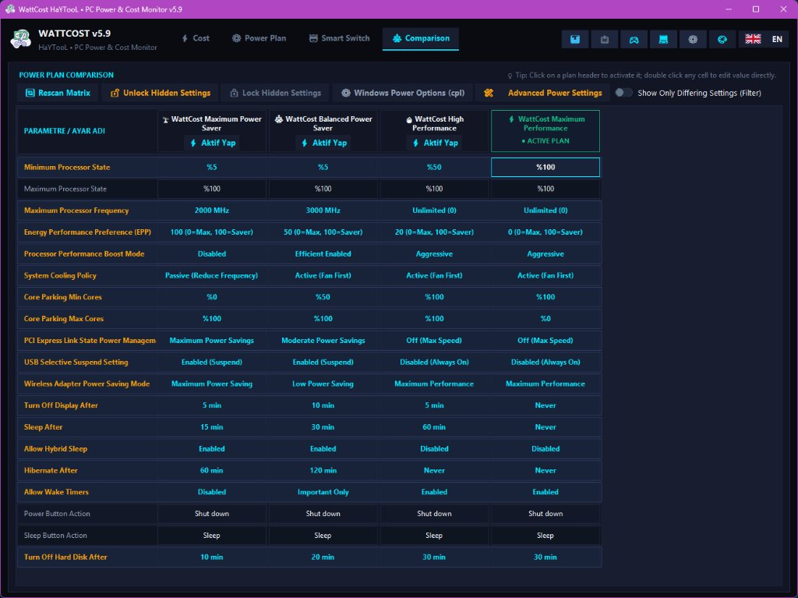
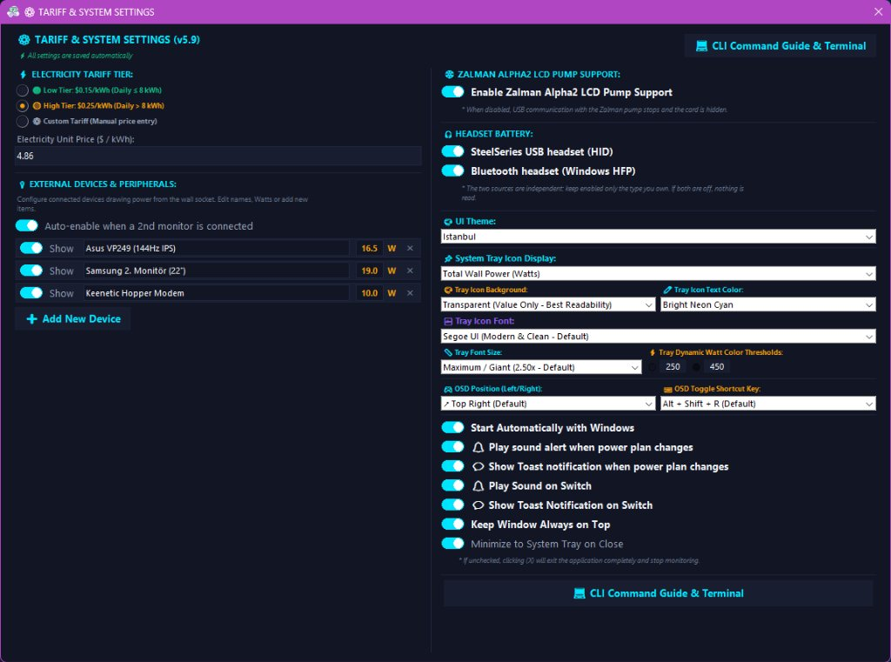

<div align="center">

# ⚡ WattCost HaYTooL
### Real-Time PC Wall Power, Electricity Cost Tracker & Smart Automation Engine

[](https://github.com/HaYToKoRaZ/WattCost/releases)
[](https://www.microsoft.com/windows)
[](https://www.python.org/)
[](LICENSE)
[](https://www.guru3d.com/download/rtss-rivatuner-statistics-server-download/)
[](https://www.msi.com/Landing/afterburner/graphics-cards)
[](https://www.aida64.com/)
[]()

<br>

<p align="center">
  <a href="#-english-documentation">
     <b>English Documentation</b>
  </a>
  &nbsp;&nbsp;&nbsp;&nbsp; | &nbsp;&nbsp;&nbsp;&nbsp;
  <a href="#-türkçe-dokümantasyon">
     <b>Türkçe Dokümantasyon</b>
  </a>
</p>

---

</div>

<br>

<a name="-english-documentation"></a>
# 🇬🇧 English Documentation

> **WattCost HaYTooL** is a lightweight, high-precision hardware telemetry and automation suite designed for Windows 10 & 11. It computes real-time wall socket power draw (in Watts) and financial electricity costs, renders an in-game RivaTuner (RTSS) OSD, controls Windows power plans dynamically (SmartSwitch), scales monitor refresh rates (Hz), and drives Zalman Alpha2 LCD pumps with ultra-low resource usage.

---

### ⚠️ Essential Prerequisite (Hardware Sensor Telemetry)

> [!IMPORTANT]
> To calculate real-time wall socket power draw and display GPU/CPU metrics, **WattCost HaYTooL requires at least ONE of the following background applications to be running**:
> 1. **MSI Afterburner (Recommended / Primary):** Operates via `MAHMSharedMemory`. Gives immediate, zero-lag access to CPU/GPU clock, temperatures, wattage, and utilization.
> 2. **AIDA64 (Fallback / Alternative):** Operates via `AIDA64_SensorValues` (Shared Memory XML). Automatically takes over if MSI Afterburner is closed.
>
> *No third-party kernel drivers or invasive ring-0 background services are installed on your Windows system.*

---

### 🌟 Key Highlights

- **🔌 Accurate Wall Socket Power Model:** Calculates actual wall draw using calibrated hardware coefficients:
  $$\text{Chassis Power (W)} = 46.7 + 1.632 \times \text{CPU}_{\text{Watt}} + 1.170 \times \text{GPU}_{\text{Watt}}$$
  $$\text{Total Wall Power (W)} = \text{Chassis Power} + \sum \text{Monitors} + \text{Modem} + \text{External Devices}$$
  > *Note on Hardware Calibration:* Power models and baseline constants are meticulously bench-tested and calibrated against a physical kill-a-watt wall meter on an **AMD Ryzen 7 5800X, NVIDIA RTX 5070 12GB, 32GB RAM system with full ARGB lighting setup** (base chassis + fans ~46.7W).*
- **❄️ Zalman Alpha2 LCD Pump Support (Better than OEM):**
  - Displays real-time temperatures on the liquid cooler's LCD pump screen.
  - Allows cycling between **CPU, GPU, or Highest Temperature** with customizable display time and blank screen intervals.
  - **Much Lower CPU & RAM Footprint:** Operates with a fraction of the memory and processing overhead compared to the OEM manufacturer utility while offering significantly more features.
- **⚙️ Power Plan Engine & Fine-Tuning:**
  - One-click application of optimized pre-calibrated profiles (**Maximum Power Saver, Balanced Power Saver, High Performance, Maximum Performance**), AMD Ryzen profiles, and Windows Ultimate Performance.
  - Unlock hidden Windows power settings and fine-tune attributes directly in-app.
- **🤖 SmartSwitch Dynamic Automation:** Automatically switches power plans and scales monitor refresh rates (Hz) based on real-time CPU/GPU loads or active 3D games.
- **🎮 In-Game RTSS OSD Overlay:** Fully customizable HUD inside games showing live Watts, Hourly Cost (₺/$/€), Session Total, FPS, CPU/GPU stats, and Headset Battery.
- **🎧 Dual Headset Battery Telemetry (SteelSeries & Bluetooth):**
  - **SteelSeries Wireless Headsets:** Direct USB HID protocol communication (Arctis 7, Arctis 7+, Arctis Pro, GameDAC) reading accurate battery level percentage and remaining operational time without requiring the bloat of proprietary software.
  - **Bluetooth Headsets (Windows HFP):** Reads battery percentage for any paired Bluetooth audio devices (Sony, Apple, QCY, JBL, etc.) using native Windows Bluetooth APIs and displays it both in the GUI and in-game RTSS OSD.

---

### 📸 Application Interface & Visual Overview

#### 1. ⚡ Cost & In-Game RTSS OSD Configuration
Real-time wall power draw, hourly tariff cost, active session expense, hardware telemetry, and customizable in-game RTSS overlay settings.
<p align="center">
  
</p>

#### 2. ⚙️ Power Plan Management & Presets
One-click profile activation, clone profiles, unlock hidden power options, and pre-packaged WattCost and AMD Ryzen profiles.
<p align="center">
  
</p>

#### 3. 🤖 SmartSwitch Load & Monitor Refresh Rate (Hz) Automation
Automated 4-tier power plan switching and dynamic monitor refresh rate scaling between desktop idle and 3D gaming.
<p align="center">
  
</p>

#### 4. ⚖️ Power Plan Comparison Matrix
Side-by-side comparison of processor states, core parking, cooling policy, and boost modes across profiles.
<p align="center">
  
</p>

#### 5. ⚙️ Tariff, External Devices & System Settings
Tariff tier selector ($/₺ per kWh), connected monitor wattages, Zalman pump settings, system tray styles, and notification alerts.
<p align="center">
  
</p>

---

### ⚙️ Configuration & INI Options (`WattCost. HaYTooL.ini`)

All preferences are stored in the easily editable `WattCost. HaYTooL.ini` file:

| Section | Key | Default | Description |
| :--- | :--- | :--- | :--- |
| `[Genel_Ayarlar]` | `language` | `auto` | UI language (`auto`, `tr`, `en`) |
| `[Genel_Ayarlar]` | `theme` | `obsidian_cyber` | GUI theme style |
| `[Genel_Ayarlar]` | `close_to_tray` | `true` | Minimize to system tray on window close |
| `[Tarife_Ve_Donanim]` | `kwh_price_tl` | `4.86` | Electricity price per kWh |
| `[Tarife_Ve_Donanim]` | `case_base_w` | `46.7` | Idle chassis motherboard and fan baseline (W) |
| `[Tarife_Ve_Donanim]` | `psu_efficiency` | `0.85` | Power Supply 80+ efficiency rating |
| `[RTSS_Oyun_Ici_Gosterge]` | `rtss_enabled` | `true` | Enable RTSS game overlay hook |
| `[RTSS_Oyun_Ici_Gosterge]` | `rtss_hotkey` | `Alt+Shift+R` | In-game OSD toggle shortcut |
| `[Guc_Yonetimi]` | `smart_switch_enabled` | `false` | Enable automated 4-tier power plan switching |
| `[Guc_Yonetimi]` | `smart_switch_hz_enabled` | `true` | Enable dynamic monitor refresh rate scaling |
| `[Zalman_Pompa]` | `zalman_active` | `true` | Forward hardware temps to Zalman Alpha2 LCD |

---

### 💻 CLI & Automation Guide

```bash
# Display system telemetry and current power plan
WattCost. HaYTooL.exe --status

# List all system power plans and their GUIDs
WattCost. HaYTooL.exe --list-plans

# Switch power plan by index (1-4) or plan name
WattCost. HaYTooL.exe --plan 4
WattCost. HaYTooL.exe --plan "Ultimate Performance"

# SmartSwitch automation controls
WattCost. HaYTooL.exe --smart on
WattCost. HaYTooL.exe --smart off
WattCost. HaYTooL.exe --smart toggle

# RTSS OSD overlay controls
WattCost. HaYTooL.exe --osd toggle

# Set monitor refresh rate
WattCost. HaYTooL.exe --hz 144
```

---

<br>
<br>

<a name="-türkçe-dokümantasyon"></a>
# 🇹🇷 Türkçe Dokümantasyon

> **WattCost HaYTooL**, Windows 10 ve 11 için geliştirilmiş hafif, yüksek hassasiyetli bir donanım telemetrisi ve güç optimizasyon aracıdır. Donanım sensörlerini anlık okuyarak bilgisayarınızın prizden çektiği gerçek gücü (Watt) ve elektrik faturası maliyetini (TL) hesaplar, oyun içi RTSS OSD göstergesi sunar, akıllı güç planı geçişleri (SmartSwitch), dinamik monitör Hz yönetimi ve Zalman LCD pompa entegrasyonu sağlar.

---

### ⚠️ Zorunlu Önkoşul (Donanım Telemetri İhtiyacı)

> [!IMPORTANT]
> Uygulamanın tam verimli çalışması, priz gücünü (Watt) hesaplayabilmesi ve CPU/GPU donanım metriklerini okuyabilmesi için **arka planda aşağıdaki 2 yazılımdan EN AZ BİRİNİN açık olması gerekmektedir**:
> 1. **MSI Afterburner (Önerilen / Birincil):** `MAHMSharedMemory` üzerinden çalışır. CPU/GPU güç tüketimi (W), sıcaklıklar, frekanslar ve kullanım oranlarını sıfır gecikmeyle sağlar.
> 2. **AIDA64 (Yedekli / Alternatif):** `AIDA64_SensorValues` (Paylaşımlı Bellek XML) üzerinden çalışır. MSI Afterburner kapalı olduğunda otomatik olarak devreye girer.
>
> *Sisteminize herhangi bir üçüncü taraf güvensiz kernel sürücüsü yüklenmez; telemetri tamamen standart paylaşımlı bellek üzerinden güvenle okunur.*

---

### 🌟 Öne Çıkan Özellikler

- **🔌 Gerçekçi Priz Gücü Hesaplama Modeli:** Donanım testleriyle kalibre edilmiş priz güç formülü:
  $$\text{Kasa Gücü (W)} = 46.7 + 1.632 \times \text{CPU}_{\text{Watt}} + 1.170 \times \text{GPU}_{\text{Watt}}$$
  $$\text{Toplam Priz Gücü (W)} = \text{Kasa Gücü} + \text{Monitörler} + \text{Modem} + \text{Ek Cihazlar}$$
  > *Donanım Kalibrasyonu Notu:* Güç modeli ve katsayılar, **AMD Ryzen 7 5800X, NVIDIA RTX 5070 12GB, 32GB RAM ve Full ARGB aydınlatmalı** gerçek bir sistem üzerinde priz tipi wattmetre ile bizzat test edilerek kalibre edilmiştir (kasa tabanı + fanlar ~46.7W).*
- **❄️ Zalman Alpha2 LCD Pompa Desteği (Kendi Yazılımından Üstün):**
  - Sıvı soğutmanın pompa ekranına canlı sıcaklık bilgilerini aktarır.
  - **CPU, GPU veya En Yüksek Sıcaklık (Max)** arasında otomatik döngü yapabilir; ekranda kalma ve ekran kararma süreleri saniyesine kadar özelleştirilebilir.
  - **Daha Düşük CPU ve RAM Kullanımı:** Kendi resmi üretici yazılımına kıyasla çok daha az sistem kaynağı ve bellek tüketirken, çok daha fazla özelleştirme ve özellik sunar.
- **⚙️ Gelişmiş Güç Planı Motoru & İnce Ayarlar:**
  - Tek tıkla hazır optimize edilmiş profiller (**Maksimum Tasarruf, Dengeli Tasarruf, Yüksek Performans, Maksimum Performans**), AMD Ryzen güç profilleri ve Windows Ultimate Performance modu.
  - Windows'un gizli güç ayarlarını açma, planları klonlama ve doğrudan arayüzden ince detaylarını özelleştirme imkanı.
- **🤖 SmartSwitch Akıllı Güç & Monitör Hz Otomasyonu:** Sistem boştayken enerji tasarrufuna geçer; 3D oyun veya yüksek işlem yükü algılandığında sistemi ve monitör yenileme hızını (örn. 60Hz'den 144Hz'e) otomatik olarak en üst kademeye taşır.
- **🎮 Oyun İçi RTSS OSD:** RivaTuner Statistics Server üzerinden oyun ekranına canlı Priz Gücü (W), Saatlik Ücret (TL), Oturum Tutarı, FPS ve donanım kullanım yüzdelerini yansıtır.
- **🎧 Çift Kanallı Kulaklık Batarya Takibi (SteelSeries & Bluetooth):**
  - **SteelSeries Kablosuz Kulaklıklar:** Üreticinin ağır yazılımına ihtiyaç duymadan USB HID protokolü ile doğrudan iletişim kurarak (Arctis 7, Arctis 7+, Arctis Pro vb.) net şarj yüzdesi ve tahmini kalan kullanım süresini okur.
  - **Bluetooth Kulaklıklar (Windows HFP):** Eşleştirilmiş tüm Bluetooth kulaklıkların (Sony, Apple, QCY, JBL vb.) batarya yüzdesini yerel Windows API'leri üzerinden anlık okuyarak hem arayüze hem de oyun içi RTSS OSD göstergesine yansıtır.

---

### 📸 Arayüz ve Görsel Tanıtım

#### 1. ⚡ Maliyet & Oyun İçi RTSS OSD Ayarları
Anlık priz gücü, saatlik elektrik maliyeti, oturum harcaması ve oyun içi RTSS gösterge özelleştirmeleri.
<p align="center">
  
</p>

#### 2. ⚙️ Güç Planı Yönetimi & Hazır Düzenler
Hazır optimize WattCost ve AMD Ryzen güç planları, tek tıkla geçiş, profil klonlama ve gelişmiş ayarlar.
<p align="center">
  
</p>

#### 3. 🤖 SmartSwitch Yük & Monitör Hz Otomasyonu
Sistem yükü ve oyun algılamasına göre 4 kademeli otomatik güç planı ve dinamik monitör yenileme hızı (Hz) değişimi.
<p align="center">
  
</p>

#### 4. ⚖️ Güç Planı Karşılaştırma Matrisi
Tüm güç planlarının işlemci frekans sınırları, çekirdek park etme (core parking) ve soğutma politikalarını yan yana kıyaslama.
<p align="center">
  
</p>

#### 5. ⚙️ Tarife, Çevre Birimleri & Sistem Ayarları
Elektrik birim fiyatı (TL/kWh), prize bağlı harici cihazlar (monitör, modem), Zalman pompa ayarları ve bildirimler.
<p align="center">
  
</p>

---

### ⚙️ Yapılandırma ve INI Dosyası (`WattCost. HaYTooL.ini`)

Tüm ayarlar `WattCost. HaYTooL.ini` dosyasında tutulur ve elle düzenlenebilir:

| Bölüm | Anahtar | Varsayılan | Açıklama |
| :--- | :--- | :--- | :--- |
| `[Genel_Ayarlar]` | `language` | `auto` | Arayüz dili (`auto`, `tr`, `en`) |
| `[Genel_Ayarlar]` | `theme` | `obsidian_cyber` | Arayüz renk teması |
| `[Genel_Ayarlar]` | `close_to_tray` | `true` | Kapatıldığında saatin yanına küçült |
| `[Tarife_Ve_Donanim]` | `kwh_price_tl` | `4.86` | Elektrik kWh birim fiyatı (TL) |
| `[Tarife_Ve_Donanim]` | `case_base_w` | `46.7` | Kasa boştaki anakart ve fan taban gücü (W) |
| `[Tarife_Ve_Donanim]` | `psu_efficiency` | `0.85` | Güç kaynağı 80+ verimlilik katsayısı |
| `[RTSS_Oyun_Ici_Gosterge]` | `rtss_enabled` | `true` | RTSS göstergesini etkinleştir |
| `[RTSS_Oyun_Ici_Gosterge]` | `rtss_hotkey` | `Alt+Shift+R` | Gösterge kısayol tuşu |
| `[Guc_Yonetimi]` | `smart_switch_enabled` | `false` | 4 kademeli akıllı geçiş motorunu aç |
| `[Guc_Yonetimi]` | `smart_switch_hz_enabled` | `true` | Dinamik monitör Hz değişimini aç |
| `[Zalman_Pompa]` | `zalman_active` | `true` | Sıcaklıkları Zalman LCD pompaya gönder |

---

### 💻 Terminal ve CLI Kılavuzu

```bash
# Sistem guc ve telemetri durumunu konsola yazdirir
WattCost. HaYTooL.exe --status

# Sistemdeki guc planlarini ve GUID kodlarini listeler
WattCost. HaYTooL.exe --list-plans

# Guc planini sira no veya isimle degistirir
WattCost. HaYTooL.exe --plan 4
WattCost. HaYTooL.exe --plan "Maksimum Performans"

# Akilli Gecis (SmartSwitch) modunu kontrol eder
WattCost. HaYTooL.exe --smart on
WattCost. HaYTooL.exe --smart off
WattCost. HaYTooL.exe --smart toggle

# RTSS OSD gostergesini acar / kapatir
WattCost. HaYTooL.exe --osd toggle

# Monitor yenileme hizini ayarlar
WattCost. HaYTooL.exe --hz 144
```

---

<div align="center">
Developed with ❤️ by <b>HaYTooL Studio</b>
</div>
